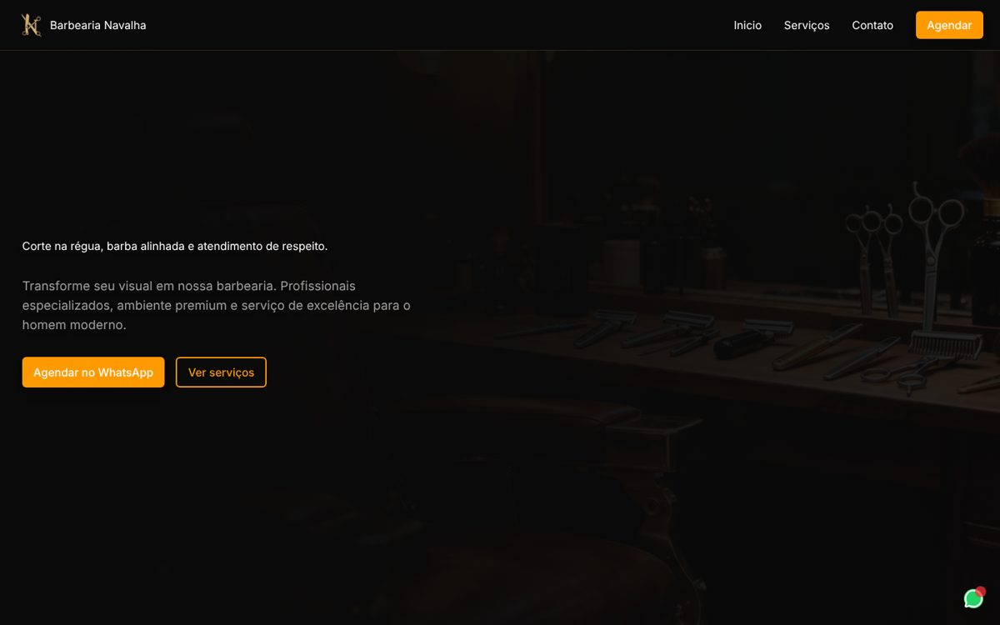
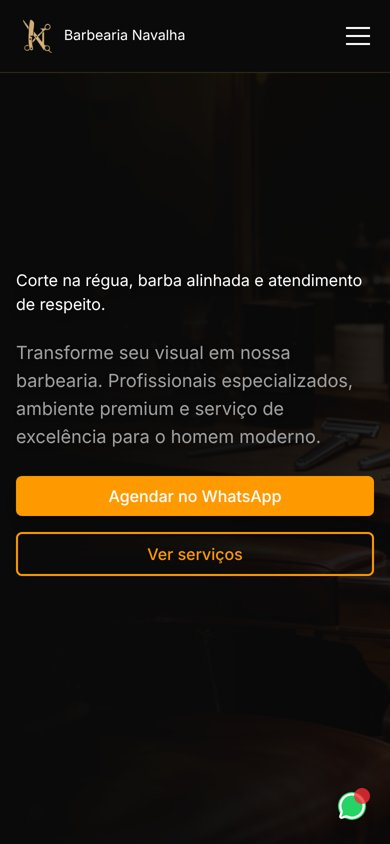

# ✂️ Barbearia Navalha — Landing Page

Landing page para uma barbearia, pensada para **transformar visitas em agendamentos pelo WhatsApp**. Visual escuro com detalhes em dourado, layout responsivo e chamadas para ação em todos os pontos da página.

<p align="center">
  
  &nbsp;
  
</p>
<p align="center"><em>Desktop e mobile — layout 100% responsivo</em></p>

## 🎯 Objetivo

Barbearias vivem de agenda cheia. Esta página foi construída com um único foco: levar o cliente do primeiro contato ao agendamento com o menor número de cliques possível.

## ✨ Funcionalidades

- **Hero com CTA duplo** — "Agendar no WhatsApp" ou rolagem suave até os serviços
- **Catálogo de serviços** — cards com ícone, descrição e preço, gerados a partir de um array de dados
- **Seção de contato** — endereço, horário de funcionamento e WhatsApp
- **Botão flutuante de WhatsApp** — sempre visível, em qualquer ponto da página
- **Menu responsivo** — menu hambúrguer animado no mobile
- **Rodapé** com links para Instagram, WhatsApp e localização no Google Maps

## 🛠️ Tecnologias

| Tecnologia | Uso |
|---|---|
| [React 19](https://react.dev/) | Interface em componentes |
| [TypeScript](https://www.typescriptlang.org/) | Tipagem das props e componentes |
| [Vite](https://vite.dev/) | Ambiente de desenvolvimento e build |
| [Tailwind CSS 4](https://tailwindcss.com/) | Estilização |
| [Lucide React](https://lucide.dev/) | Ícones |
| ESLint | Padronização do código |

## 📁 Estrutura

```
src/
├── components/
│   ├── Hero.tsx            # Seção principal com CTAs
│   ├── Services.tsx        # Lista de serviços
│   ├── ServiceCard.tsx     # Card reutilizável de serviço
│   ├── Contact.tsx         # Informações de contato
│   └── shared/
│       ├── Header.tsx      # Cabeçalho + menu mobile
│       ├── Footer.tsx      # Rodapé com redes sociais
│       ├── Button.tsx      # Botão com variantes primary/secondary
│       └── WhatsAppButton.tsx  # Botão flutuante
├── assets/                 # Imagens e logo
├── styles/globals.css      # Estilos globais e tema
├── App.tsx
└── main.tsx
```

## 🚀 Como rodar o projeto

**Pré-requisito:** [Node.js](https://nodejs.org/) 20 ou superior.

```bash
# Clone o repositório
git clone https://github.com/DanieSolinho/barbearia-navalha.git

# Entre na pasta
cd barbearia-navalha

# Instale as dependências
npm install

# Rode em modo de desenvolvimento
npm run dev
```

Acesse `http://localhost:5173` no navegador.

### Outros comandos

| Comando | O que faz |
|---|---|
| `npm run build` | Gera a versão de produção na pasta `dist/` |
| `npm run preview` | Visualiza a build de produção localmente |
| `npm run lint` | Verifica o código com o ESLint |

## 🔧 Personalização

Para adaptar a página a outra barbearia:

- **Serviços e preços:** edite o array `services` em `src/components/Services.tsx`
- **WhatsApp:** troque o número nos links `wa.me` dos componentes
- **Endereço e horário:** `src/components/Contact.tsx`
- **Logo e imagem de fundo:** substitua os arquivos em `src/assets/`

## 👩‍💻 Autora

Desenvolvido por **Daniella Solinho**

[](https://github.com/DanieSolinho)
[](https://daniellasolinho.com.br)
